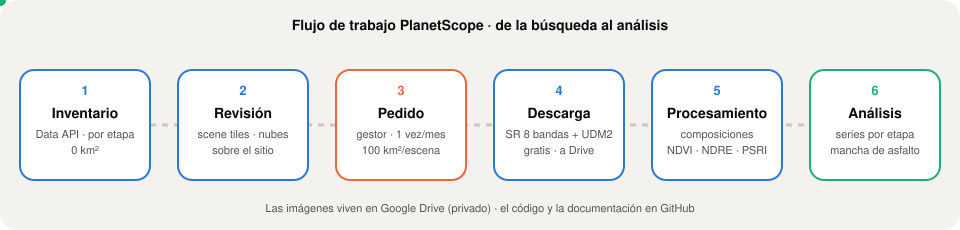
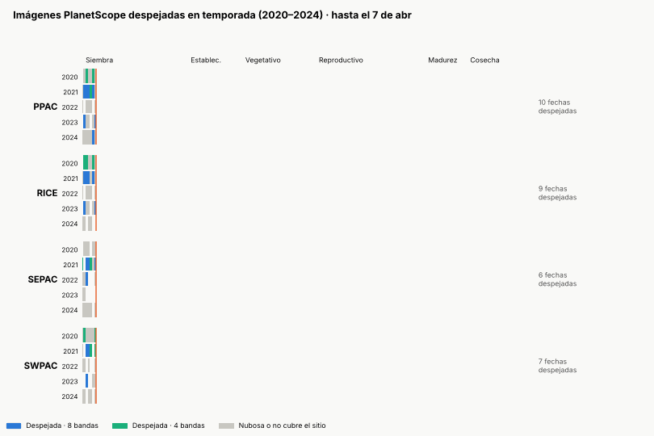
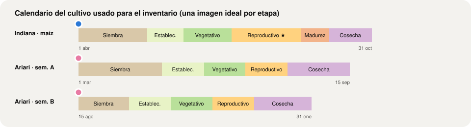
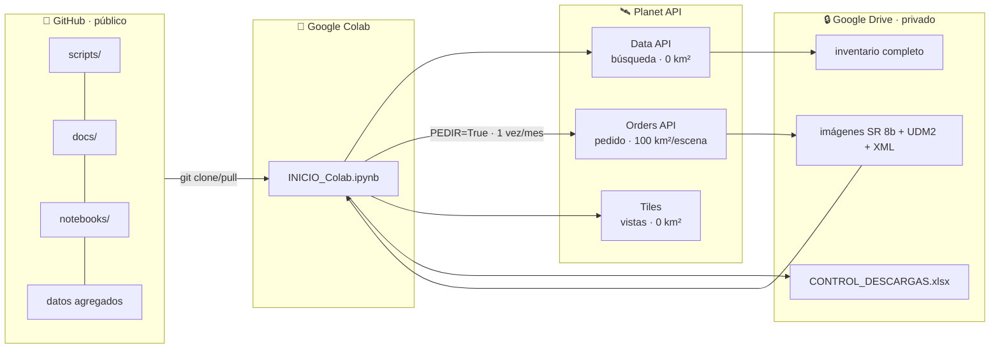

<!-- ═══════════════════════════ ENCABEZADO ANIMADO ═══════════════════════════ -->
<p align="center">
  
</p>

<p align="center">
  <a href="https://github.com/jf-floresriera/PlanetScope_inventory">
    
  </a>
</p>

<p align="center">
  
  
  
  
  
</p>

---

## 🛰️ ¿Qué es este repositorio?

Documenta el **flujo metodológico completo** para buscar, inventariar, descargar con control de cuota y analizar
imágenes **PlanetScope** (Planet Labs, programa *Education & Research*) en la tesis sobre la
**mancha de asfalto del maíz** (*tar spot*, *Phyllachora maydis*):

| | Sitio | Lugar | Calendario |
|---|---|---|---|
| 🌽 | **PPAC** · Pinney Purdue Agricultural Center | Porter, Indiana | Maíz · 1 abr → 31 oct |
| 🌽 | **RICE** · Purdue Mary S. Rice Farm | LaPorte, Indiana | Maíz · 1 abr → 31 oct |
| 🌽 | **SEPAC** · Southeast Purdue Agricultural Center | Jennings, Indiana | Maíz · 1 abr → 31 oct |
| 🌽 | **SWPAC** · Southwest Purdue Agricultural Center | Knox, Indiana | Maíz · 1 abr → 31 oct |
| 🌾 | **ARIARI** · Río Ariari – El Castillo | Meta, Colombia | Semestres A y B |

<p align="center"></p>

---

## 📈 El inventario en movimiento

Cada franja es un día de la temporada; cada fila, un año. Así se van acumulando las fechas con imagen despejada
(datos agregados del inventario 2020–2024, Indiana):

<p align="center"></p>

<details>
<summary><b>📊 Números clave del inventario (clic para ver)</b></summary>

| Indicador (Indiana, 2020–2024, 1 abr – 31 oct) | Valor |
|---|---|
| Escenas encontradas | **5.658** |
| Fechas con imagen por sitio y temporada | 131 – 186 |
| Fechas despejadas por sitio y temporada | 54 – 91 |
| Fechas despejadas en etapa reproductiva (ventana de la mancha de asfalto) | ~8 – 20 por sitio y año |
| Escenas de 8 bandas (SuperDove) | 14 % (2020) → 60 % (2021) → **99–100 %** (2022–2024) |

Tablas completas: [`datos/RESUMEN_INVENTARIO_POR_ETAPA.csv`](datos/RESUMEN_INVENTARIO_POR_ETAPA.csv) ·
[`datos/RESUMEN_INVENTARIO_SITIO_ANIO.csv`](datos/RESUMEN_INVENTARIO_SITIO_ANIO.csv)
</details>

---

## 🌱 Calendario del cultivo

<p align="center"></p>

---

## ⚠️ La regla de oro de la cuota

<p align="center"></p>

> [!IMPORTANT]
> Con el plan E&R Basic **cada escena pedida cuesta mínimo 100 km²**, aunque se recorte 1 km².
> Hay **3.000 km²/mes** → ≈ **29 escenas al mes**. Los pedidos se hacen **solo** con el gestor, **una vez al mes**.
> Descargar lo ya pedido es **gratis**. Detalles en [`docs/02_cuota_y_pedidos.md`](docs/02_cuota_y_pedidos.md).

---

## 🚀 Inicio rápido (Google Colab)

[](https://colab.research.google.com/github/jf-floresriera/PlanetScope_inventory/blob/main/notebooks/INICIO_Colab.ipynb)

```python
# 1 · Drive + API key (nunca la escribas en el código)
from google.colab import drive; drive.mount('/content/drive')
import os, getpass; os.environ['PL_API_KEY'] = getpass.getpass('API key de Planet: ')

# 2 · Clonar/actualizar el repo dentro de Drive
%cd /content/drive/MyDrive/Purdue_TarSpot_Project
!git clone https://github.com/jf-floresriera/PlanetScope_inventory.git || (cd PlanetScope_inventory && git pull)
S = '/content/drive/MyDrive/Purdue_TarSpot_Project/PlanetScope_inventory/scripts'

# 3 · Descargar lo ya pedido + control + plan (PEDIR = False → no gasta)
%run -i $S/planet_gestor_descargas.py

# 4 · Composiciones de color
%run -i $S/planet_composiciones.py
```

---

## 🧭 Arquitectura: qué vive dónde



---

## 📚 Documentación de procesos

| # | Proceso | Documento |
|:-:|---|---|
| 0 | Contexto completo del proyecto | [`docs/00_contexto_proyecto.md`](docs/00_contexto_proyecto.md) |
| 1 | Inventario por etapa del cultivo (Data API) | [`docs/01_inventario.md`](docs/01_inventario.md) |
| 2 | Cuota y pedidos mes a mes | [`docs/02_cuota_y_pedidos.md`](docs/02_cuota_y_pedidos.md) |
| 3 | Descarga, registro y control | [`docs/03_descarga_y_control.md`](docs/03_descarga_y_control.md) |
| 4 | Composiciones de color e índices | [`docs/04_composiciones_e_indices.md`](docs/04_composiciones_e_indices.md) |
| 5 | Scene tiles y mosaicos mensuales | [`docs/05_tiles_y_basemaps.md`](docs/05_tiles_y_basemaps.md) |
| 6 | Sesión de trabajo: Colab + Drive + GitHub | [`docs/06_sesion_colab_github.md`](docs/06_sesion_colab_github.md) |
| 7 | Qué datos se pueden publicar (licencia E&R) | [`docs/07_datos_y_licencia.md`](docs/07_datos_y_licencia.md) |
| 📓 | Bitácora del proyecto | [`docs/BITACORA.md`](docs/BITACORA.md) |

---

## 🗂️ Estructura

```
PlanetScope_inventory/
├── 📄 README.md
├── 🎞️ assets/          animaciones del README (SVG/GIF)
├── 📚 docs/            procesos documentados + bitácora
├── 🐍 scripts/         gestor de descargas, composiciones, tiles, índices, inventario
├── 📓 notebooks/       INICIO_Colab.ipynb + cuaderno multisensor v3
├── 📊 datos/           sitios y tablas AGREGADAS (sin imágenes de Planet)
├── 🖼️ resultados/      figuras del inventario
└── 🧰 herramientas/    generadores de las animaciones
```

Cada carpeta tiene su propio `README.md`.

---

## 📝 Cita obligatoria (programa E&R de Planet)

```
Planet Team (2026). Planet Application Program Interface: In Space for Life on Earth. San Francisco, CA. https://api.planet.com
```

<p align="center">
  <b>Jesús Enrique Flores Riera</b> · Universidad Nacional de Colombia<br/>
  <sub>Imágenes PlanetScope © Planet Labs PBC — uso académico no comercial (programa Education & Research).</sub>
</p>


