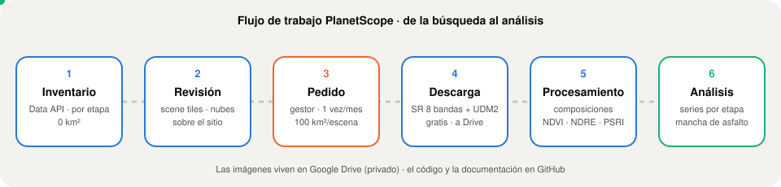
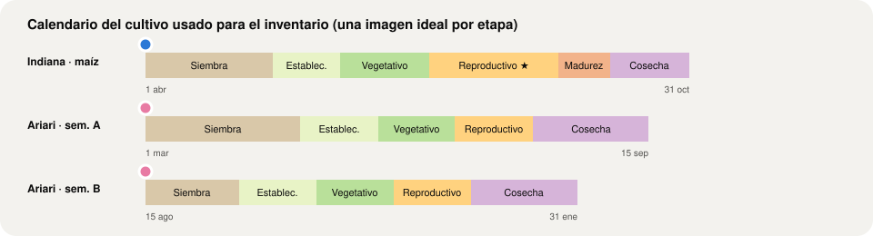

# 🎞️ assets/

| Archivo | Tipo | Contenido |
|---|---|---|
| [`flujo_animado.svg`](flujo_animado.svg) | SVG animado (CSS + SMIL) | Flujo de 6 pasos: inventario → revisión → pedido → descarga → procesamiento → análisis |
| [`cuota_animada.svg`](cuota_animada.svg) | SVG animado | Cuántas escenas caben en 3.000 km² según el tipo de pedido |
| [`fenologia_animada.svg`](fenologia_animada.svg) | SVG animado | Calendario del cultivo (Indiana y Ariari A/B) |
| [`inventario_animado.gif`](inventario_animado.gif) | GIF | Fechas despejadas acumulándose en la temporada (datos agregados). Se regenera con [`herramientas/generar_gif_inventario.py`](../herramientas/generar_gif_inventario.py) |

