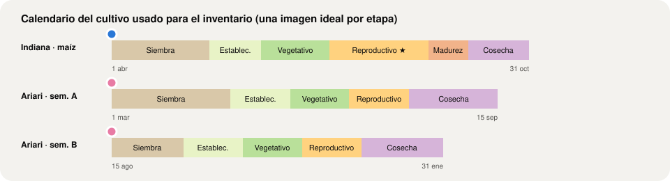

# Contexto del proyecto (para retomar el trabajo en cualquier momento)

## 1. Objetivo

Construir series de imágenes **PlanetScope** por **etapa del cultivo** para estudiar la mancha de asfalto
(*tar spot*, *Phyllachora maydis*) en maíz, y complementarlas con los sensores del cuaderno multisensor
(Sentinel-2 L2A, Landsat 8/9 C2 L2, EMIT, PACE, AVIRIS, EnMAP y GEDI).

## 2. Sitios

| Sitio | Nombre | Lugar | Lat | Lon | Calendario |
|---|---|---|---|---|---|
| PPAC | Pinney Purdue Agricultural Center | Porter, Indiana | 41.4432 | −86.9301 | Maíz Indiana |
| RICE | Purdue Mary S. Rice Farm | LaPorte, Indiana | 41.3269 | −86.8028 | Maíz Indiana |
| SEPAC | Southeast Purdue Agricultural Center | Jennings, Indiana | 39.0357 | −85.5291 | Maíz Indiana |
| SWPAC | Southwest Purdue Agricultural Center | Knox, Indiana | 38.7372 | −87.4845 | Maíz Indiana |
| ARIARI | Río Ariari – El Castillo | Meta, Colombia | 3.650321 | −73.782597 | Semestres A y B |

Fuente Indiana: Tabla 1 del proyecto de tesis (sección 7.3). Aún **no hay polígonos de las fincas/parcelas**
(`plot_geometry_available = false`); se usan cuadrados alrededor del punto. **Pendiente: conseguir los
límites de las fincas** para recortar a su forma exacta.

## 3. Calendarios de cultivo (etapas)

**Indiana – maíz** (campaña 1 abr – 31 oct, igual que `SOLO_CAMPANA` del cuaderno de sensores):

| Etapa | Ventana |
|---|---|
| Siembra | 01-abr → 20-may |
| Establecimiento (VE–V5) | 21-may → 15-jun |
| Vegetativo (V6–VT) | 16-jun → 20-jul |
| Reproductivo (R1–R5) · ventana crítica de mancha de asfalto | 21-jul → 10-sep |
| Madurez (R6) | 11-sep → 30-sep |
| Cosecha | 01-oct → 31-oct |

**Ariari – piedemonte del Meta** (arroz/maíz; basado en fechas de siembra del ICA):

| Etapa | Semestre A | Semestre B |
|---|---|---|
| Siembra | 01-mar → 30-abr | 15-ago → 20-sep |
| Establecimiento | 01-may → 31-may | 21-sep → 20-oct |
| Vegetativo | 01-jun → 30-jun | 21-oct → 20-nov |
| Reproductivo | 01-jul → 31-jul | 21-nov → 20-dic |
| Cosecha | 01-ago → 15-sep | 21-dic → 31-ene |

Ajustar con fechas reales de campo cuando estén disponibles.

## 4. Planet: qué incluye la cuenta (E&R Basic)

| Recurso | Cantidad mensual | Para qué |
|---|---|---|
| Scene downloads (preferred clipping) | 3.000 km² | Descargar escenas PlanetScope / RapidEye (RapidEye solo hasta mar-2020) |
| Scene tiles | 100.000 tiles | Ver escenas como mapa (PNG de visualización) — no gasta km² |
| Basemap tiles | 100.000 tiles | Ver mosaicos mensuales (Global Mosaics) — no gasta km² |

* Retraso de 30 días en PlanetScope. Overage: Off (al llegar al límite simplemente no deja pedir más).
* No incluye SkySat ni Tanager (hiperespectral). Planet no tiene radar → usar Sentinel-1 (ASF).
* **Buscar en la Data API (inventario) no gasta cuota.**

### Reglas de cobro (aprendidas a la fuerza)

1. **Mínimo 100 km² por escena** con recorte, aunque se recorte 1 km².
2. Sin recorte se cobra la **escena completa** (SuperDove ≈ 32 × 20 km ≈ 640 km²) → ≈ 4 escenas/mes.
3. Planet **cobra al hacer el pedido**; **descargar un pedido ya hecho es gratis** e ilimitado.
4. **Pedir otra vez la misma escena se cobra otra vez.**
5. Conclusión: recortar a **~10 × 10 km (≈ 96 km²)** → ≈ 29 escenas/mes con toda la información útil.

## 5. Producto que se pide

* Bundle `analytic_8b_sr_udm2` (si no existe, `analytic_sr_udm2`): **L3B ortorectificado, reflectancia de
  superficie (BOA)** — el equivalente a Sentinel-2 L2A. Escala: reflectancia × 10 000. Píxel 3 m.
* Archivos por escena: `*_AnalyticMS_SR_8b_clip.tif` (8 bandas), `*_udm2_clip.tif` (máscara de nubes),
  `*_metadata_clip.xml` y `*_metadata.json`.
* Bandas SuperDove: 1 Azul costero (443) · 2 Azul (490) · 3 Verde I (531) · 4 Verde (565) · 5 Amarillo (610) ·
  6 Rojo (665) · 7 Red Edge (705) · 8 NIR (865). Desde 2022 ~100 % de las escenas son de 8 bandas.
* Sin SWIR ni térmico → NDMI, NBR y temperatura se hacen con Sentinel-2 / Landsat / EnMAP.

## 6. Índices útiles para mancha de asfalto

NDVI, GNDVI, EVI2, SAVI (4 y 8 bandas) · **NDRE, CIrededge, PSRI** (solo 8 bandas, los más útiles para
clorofila y senescencia) · MTCI, CCCI, PRI aproximados. Fórmulas en [`datos/REFERENCIA_PLANETSCOPE_indices.csv`](../datos/REFERENCIA_PLANETSCOPE_indices.csv).

## 7. Resultados del inventario (Indiana, 2020–2024, temporada 1 abr – 31 oct)

* 5.658 escenas; por sitio y temporada 131–186 fechas con imagen y 54–91 fechas despejadas.
* Etapa reproductiva: ~8–20 fechas despejadas por sitio y año.
* 8 bandas: 14 % (2020), 60 % (2021), 99–100 % (2022–2024).
* Limitación: el `% despejado` de Planet es de **toda la escena**, no del sitio → verificar con UDM2 o con
  las vistas rápidas (`planet_tiles_aprovechar.py`, columna `nubes_sobre_sitio_%`).
* Ariari: pendiente de completar (`scripts/planet_completar_ariari_2025.py`). Esperar mucha nubosidad.

## 8. Pendientes

- [ ] Completar inventario: Ariari 2021–2025 e Indiana 2025.
- [ ] Bajar las 28 escenas ya pagadas (gestor con `PEDIR = False`) y generar composiciones.
- [ ] Respuesta de Soporte Planet sobre la cuota consumida por los recortes de 1 km² (nov-2026).
- [ ] Usar los tiles de noviembre antes del 1-dic (vistas rápidas + basemaps).
- [ ] 1-dic: primer pedido controlado (≈ 29 escenas, recorte ~10 × 10 km), priorizando fechas con
      `apta_para_pedir = True` en `QA_VISUAL_ESCENAS.csv`.
- [ ] Conseguir polígonos de las fincas/parcelas.
- [ ] Series de índices por etapa y comparación con Sentinel-2 / EnMAP.
