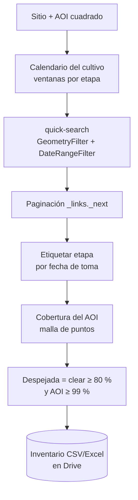
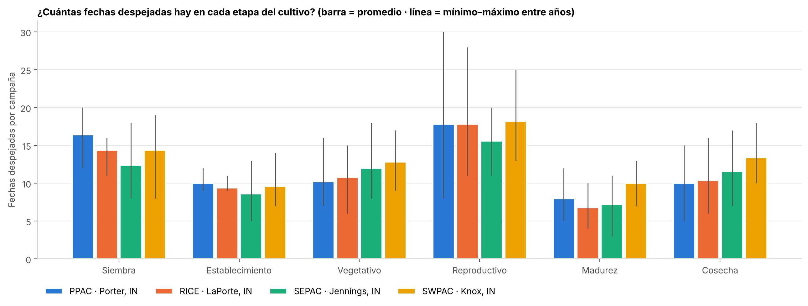
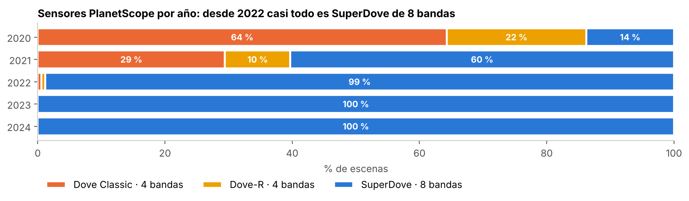

# 01 · Inventario por etapa del cultivo

> **Buscar no consume cuota.** El inventario se puede repetir todas las veces que haga falta.

## Qué hace

Consulta la **Data API** de Planet (`quick-search`) para cada sitio, campaña, año y **etapa del cultivo**,
y guarda **todos los metadatos** de cada escena PlanetScope (`PSScene`).

## Scripts

| Script | Uso |
|---|---|
| [`scripts/planet_inventario_celdas.py`](../scripts/planet_inventario_celdas.py) | Celdas P1–P10 que se agregan al cuaderno multisensor (inventario, fichas por área, gráficas, mejores escenas, Excel) |
| [`scripts/planet_completar_ariari_2025.py`](../scripts/planet_completar_ariari_2025.py) | Completa el inventario con **Ariari 2021–2025** e **Indiana 2025** y lo une a `PL_INV` |
| [`scripts/planet_graficas_e_indices.py`](../scripts/planet_graficas_e_indices.py) | Gráficas del inventario (calendario por sitio, fechas por etapa, sitio × año, sensores) |

## Columnas principales del inventario

| Columna | Significado |
|---|---|
| `sitio`, `campana`, `anio`, `etapa`, `fecha`, `hora_utc`, `doy` | Ubicación temporal de la escena en el calendario |
| `item_id` | Identificador de la escena en Planet |
| `cobertura_aoi_pct` | % del área de interés cubierto por la huella de la escena |
| `n_bandas`, `tiene_8b_sr`, `tiene_4b_sr`, `tiene_udm2` | Qué productos se pueden pedir |
| `clear_pct`, `nubes_pct`, `despejada` | Calidad (⚠️ calculada por Planet sobre **toda la escena**) |
| `p_*` | **Todos** los metadatos originales de Planet: `p_instrument`, `p_gsd`, `p_sun_elevation`, `p_view_angle`, `p_light_haze_percent`, `p_shadow_percent`, `p_quality_category`… |

## Limitación importante

El `% despejado` de Planet se calcula sobre **toda la escena** (≈ 25 × 11 km o 32 × 20 km), no sobre el sitio.
Una escena "despejada" puede tener una nube justo encima de la finca. Se corrige con:

1. Las **vistas rápidas** con scene tiles → columna `nubes_sobre_sitio_%` ([`05_tiles_y_basemaps.md`](05_tiles_y_basemaps.md)).
2. La máscara **UDM2** de las imágenes descargadas ([`03_descarga_y_control.md`](03_descarga_y_control.md)).

## Resultados (Indiana 2020–2024)

Tablas agregadas: [`datos/RESUMEN_INVENTARIO_POR_ETAPA.csv`](../datos/RESUMEN_INVENTARIO_POR_ETAPA.csv) ·
[`datos/RESUMEN_INVENTARIO_SITIO_ANIO.csv`](../datos/RESUMEN_INVENTARIO_SITIO_ANIO.csv).
El inventario completo escena por escena se guarda **solo en Drive** (ver [`07_datos_y_licencia.md`](07_datos_y_licencia.md)).
