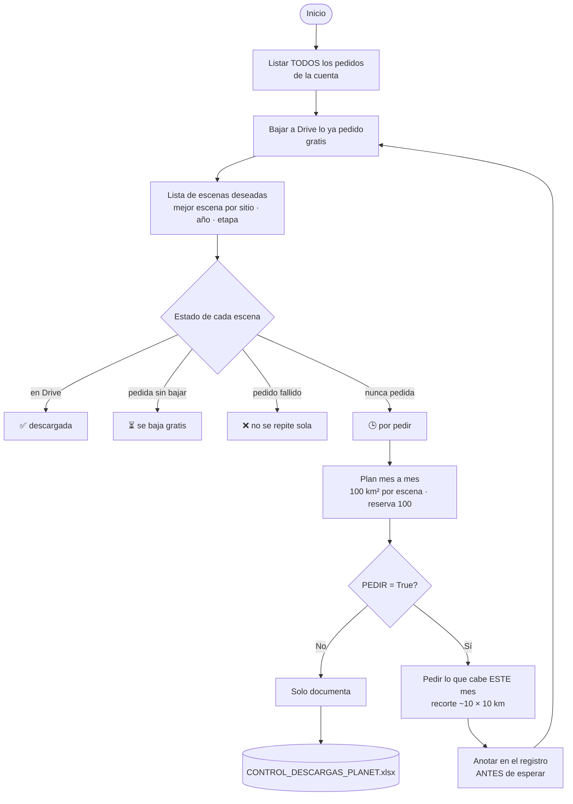

<p align="center"></p>

# 02 · Cuota y pedidos mes a mes

<p align="center"></p>

## Reglas de cobro del plan E&R Basic

| # | Regla | Consecuencia |
|:-:|---|---|
| 1 | Con recorte ("preferred clipping") se cobra **mínimo 100 km² por escena** | Un recorte de 1 km² cuesta igual que uno de ~10 × 10 km |
| 2 | Sin recorte se cobra **la escena completa** (SuperDove ≈ 640 km²) | Solo ≈ 4 escenas al mes |
| 3 | Planet cobra **al hacer el pedido**, no al descargar | Descargar lo ya pedido es gratis e ilimitado |
| 4 | Pedir **otra vez la misma escena** se cobra otra vez | El gestor nunca repite escenas |
| 5 | 3.000 km² por mes, se reinicia el día 1 · *Overage: Off* | ≈ 29 escenas/mes dejando 100 km² de reserva |

> [!CAUTION]
> **Noviembre 2026:** se pidieron 28 escenas recortadas a 1 × 1 km → se cobraron **≈ 2.800 km²**.
> Desde entonces todos los pedidos se hacen con [`scripts/planet_gestor_descargas.py`](../scripts/planet_gestor_descargas.py)
> y recortes de ~10 × 10 km.

## El gestor de descargas



## Procedimiento mensual (día 1 de cada mes)

1. Abrir [`notebooks/INICIO_Colab.ipynb`](../notebooks/INICIO_Colab.ipynb) y ejecutar las celdas 1–2.
2. En `scripts/planet_gestor_descargas.py` (copia en Drive):
   ```python
   PEDIR              = True
   CUOTA_RESTANTE_HOY = 3000      # lo que dice "Remaining" en planet.com → Plans
   ```
3. Ejecutar **una sola vez** la celda 3 (gestor).
4. Volver a `PEDIR = False`.
5. Revisar `CONTROL_DESCARGAS_PLANET.xlsx` (Drive) y anotar en [`BITACORA.md`](BITACORA.md).

## Configuración del gestor

| Parámetro | Valor | Para qué |
|---|---|---|
| `PEDIR` | `False` | `True` solo el día del pedido mensual |
| `CUOTA_RESTANTE_HOY` | km² de la cuenta | El gestor resta lo que él mismo pide después |
| `KM2_POR_ESCENA` | 100 | Mínimo cobrado por escena |
| `MARGEN_KM2` | 100 | Reserva que nunca se gasta |
| `BUFFER_PEDIDO_M` | 4900 | Recorte de 9,8 × 9,8 km ≈ 96 km² |
| `ANIOS_PRIORIDAD` | `[2024, 2023, 2022, 2021, 2025]` | Orden en que se piden los años |

## Protecciones

* Registra cada pedido en `pedidos_planet.json` **apenas Planet lo acepta**.
* Lleva su propia cuenta de km² en `control_cuota.json`: si se ejecuta dos veces seguidas, la segunda no pide nada.
* Asume la cuota completa al empezar un mes nuevo.
* Nunca pide una escena ya pedida (aunque su descarga haya fallado).
