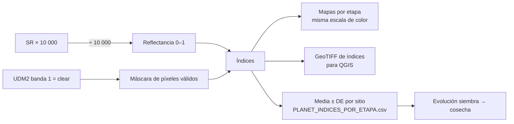

# 04 · Composiciones de color e índices

## Composiciones ([`scripts/planet_composiciones.py`](../scripts/planet_composiciones.py))

| Composición | R-G-B (8 bandas) | R-G-B (4 bandas) | Para qué sirve |
|---|:-:|:-:|---|
| Color natural | 6-4-2 | 3-2-1 | Ver el lote como el ojo: suelo, rastrojo, agua, caminos |
| Falso color infrarrojo | 8-6-4 | 4-3-2 | Vegetación sana en rojo intenso; estrés y suelo apagados |
| Red Edge | 8-7-6 | — | Diferencias de clorofila en el dosel (estrés, mancha de asfalto) |
| Senescencia | 7-5-2 | — | Amarilleo hacia madurez y cosecha |

Estiramiento común a las tres bandas (percentiles 2–98 de los píxeles válidos) con gamma 1/1,4, para conservar los tonos.
Salidas en Drive (`07_Figuras/Planet/composiciones/`): un panel por imagen, cada composición en PNG y una
**hoja de contacto por sitio** (filas = fechas/etapas, columnas = composiciones).

## Índices ([`scripts/planet_graficas_e_indices.py`](../scripts/planet_graficas_e_indices.py))

| Índice | Fórmula (bandas PlanetScope) | 4b | 8b | Utilidad |
|---|---|:-:|:-:|---|
| NDVI | (NIR − R) / (NIR + R) | ✅ | ✅ | Vigor y biomasa (se satura en dosel cerrado) |
| GNDVI | (NIR − G) / (NIR + G) | ✅ | ✅ | Clorofila |
| EVI2 | 2,5·(NIR − R) / (NIR + 2,4R + 1) | ✅ | ✅ | Dosel denso |
| SAVI | 1,5·(NIR − R) / (NIR + R + 0,5) | ✅ | ✅ | Siembra y establecimiento |
| NDWI | (G − NIR) / (G + NIR) | ✅ | ✅ | Agua y encharcamiento (Ariari) |
| **NDRE** | (NIR − RE) / (NIR + RE) | — | ✅ | ⭐ Clorofila y N, estrés temprano |
| **CIrededge** | NIR / RE − 1 | — | ✅ | ⭐ Clorofila sin saturación |
| **PSRI\*** | (R − Azul) / RE | — | ✅ | ⭐ Senescencia, avance de lesiones |
| MTCI\* · CCCI · PRI\* | ver [`datos/REFERENCIA_PLANETSCOPE_indices.csv`](../datos/REFERENCIA_PLANETSCOPE_indices.csv) | — | ✅ | Clorofila / estrés |
| NDMI · NBR · LST | requieren SWIR o térmico | ❌ | ❌ | Usar Sentinel-2 · Landsat · EnMAP |

\* Adaptados a las bandas de PlanetScope (una sola banda Red Edge, a 705 nm).

### Flujo de cálculo

> [!NOTE]
> `planet_graficas_e_indices.py` tiene `CONFIRMAR_PEDIDO = False`: **nunca** hace pedidos; trabaja con lo que ya está en Drive.
