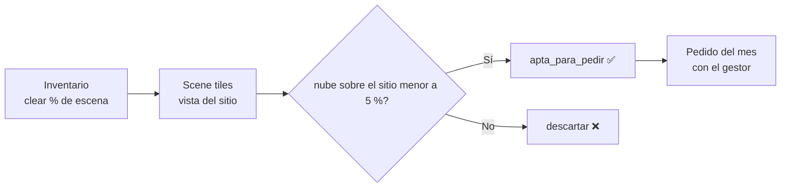

# 05 · Scene tiles y mosaicos mensuales (basemaps)

El plan incluye cada mes **100.000 scene tiles** y **100.000 basemap tiles**. Se reinician el día 1, igual que los km²,
y **no descuentan km² de descarga**. Script: [`scripts/planet_tiles_aprovechar.py`](../scripts/planet_tiles_aprovechar.py).

| | A · Scene tiles | B · Basemap tiles |
|---|---|---|
| Qué es | Cada escena como mapa (PNG color natural) | Mosaicos mensuales sin nubes armados por Planet |
| Vista | 3 × 3 km alrededor del sitio · zoom 15 | 10 × 10 km alrededor del sitio · zoom 14 |
| Costo aprox. | ~18 tiles por fecha | ~40 tiles por sitio y mes |
| Resultado clave | `nubes_sobre_sitio_%` y `apta_para_pedir` en `QA_VISUAL_ESCENAS.csv` | Hoja `BASEMAPS_<sitio>.png` (12 meses × años) |
| Sirve para | Elegir qué pedir: solo fechas limpias **sobre la finca** | Contexto, uso del suelo, Ariari (muy nublado) |

> [!WARNING]
> Las vistas son imágenes de **visualización** (8 bits): sirven para revisar y elegir, **no** para calcular índices.
> Tampoco se publican en GitHub (licencia E&R): quedan en `Drive/09_Planet_Tiles/`.

## Protecciones

* Tope configurable (`TOPE_SCENE_TILES`, `TOPE_BASEMAP_TILES` = 90.000).
* Registro de uso en `09_Planet_Tiles/uso_tiles.json`.
* No vuelve a pedir una vista que ya existe en Drive.

## Cómo se usa el resultado en el pedido mensual

