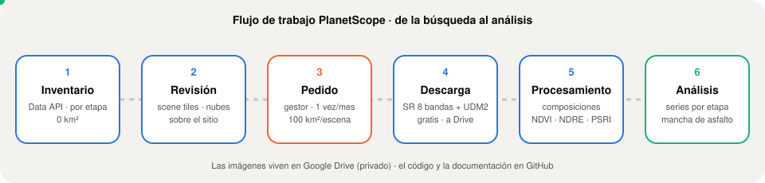

# 📚 docs/

| # | Proceso |
|:-:|---|
| 0 | [Contexto completo del proyecto](00_contexto_proyecto.md) |
| 1 | [Inventario por etapa del cultivo](01_inventario.md) |
| 2 | [Cuota y pedidos mes a mes](02_cuota_y_pedidos.md) |
| 3 | [Descarga, registro y control](03_descarga_y_control.md) |
| 4 | [Composiciones de color e índices](04_composiciones_e_indices.md) |
| 5 | [Scene tiles y mosaicos mensuales](05_tiles_y_basemaps.md) |
| 6 | [Sesión de trabajo: Colab + Drive + GitHub](06_sesion_colab_github.md) |
| 7 | [Qué datos se pueden publicar](07_datos_y_licencia.md) |
| 📓 | [Bitácora](BITACORA.md) |

